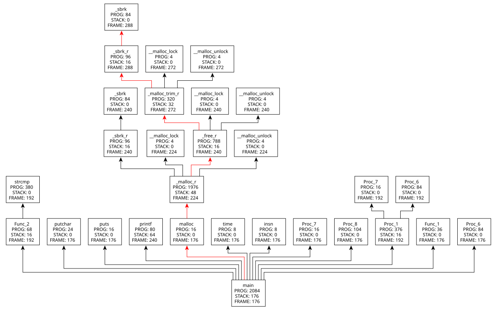
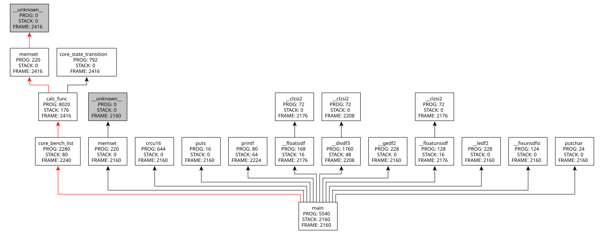
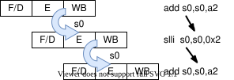
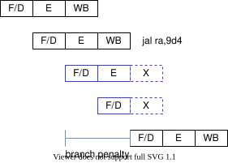
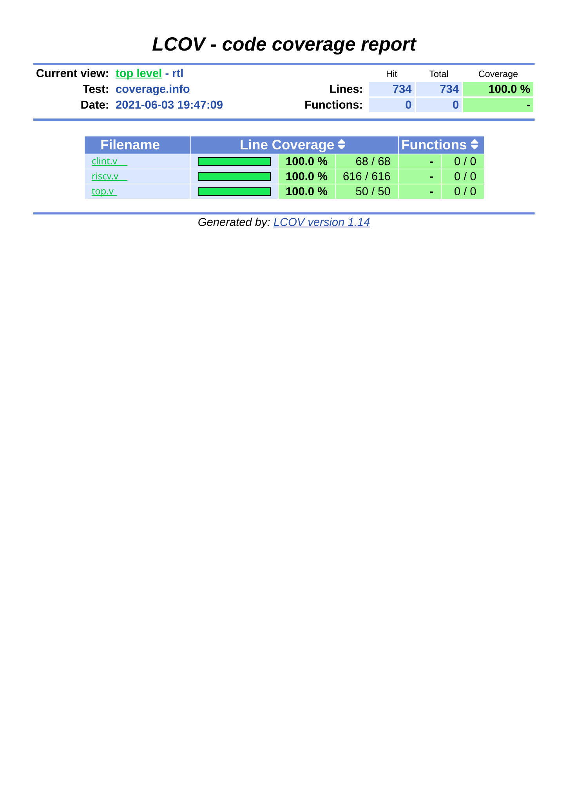
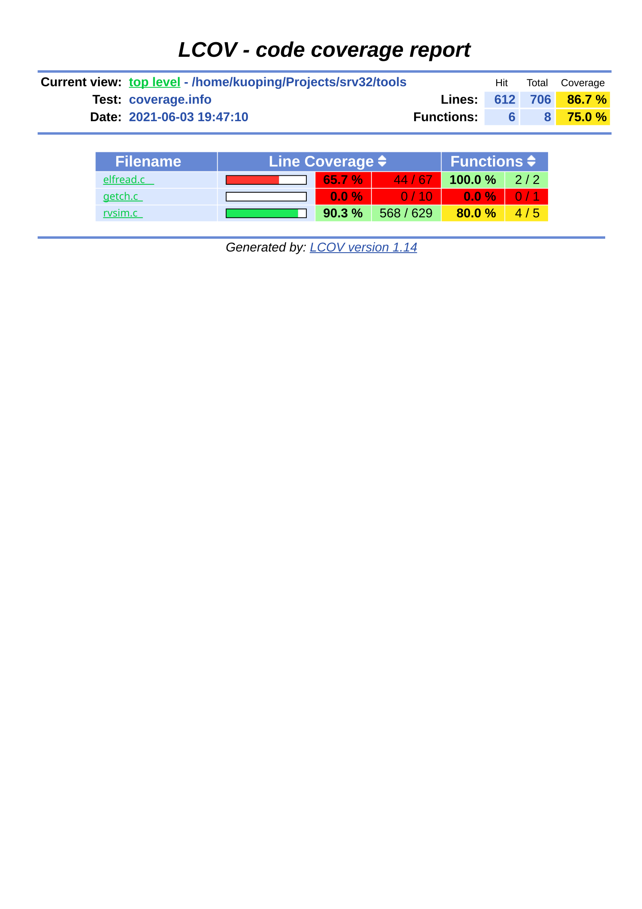

# SRV32 - Simple 3-stage pipeline RISC-V processor

[](https://www.codacy.com/manual/kuopinghsu/srv32/dashboard?utm_source=github.com&amp;utm_medium=referral&amp;utm_content=kuopinghsu/srv32&amp;utm_campaign=Badge_Grade)

SRV32 is a RISC-V processor with a three-stage pipeline. I built it to learn
the RV32IM instruction set. It also runs FreeRTOS.
With GCC 15.2.0, separate RAM, and prediction enabled, SRV32 scores
1.946 DMIPS/MHz 1.258 CPI and 3.495 CoreMark/MHz 1.165 CPI.
SRV32 is a learning project.

## Features

1.  Three-stage pipeline processor
2.  RV32IM/RV32E instruction sets
3.  Pass RV32IM [architecture test](https://github.com/riscv-non-isa/riscv-arch-test)
4.  Trap exception
5.  Interrupt handler
6.  [FreeRTOS](https://github.com/kuopinghsu/FreeRTOS-RISCV) support
7.  ISS simulator
8.  Static branch predictor

## Cloning the repository

Clone the repository and its `tools/mini-gdbstub` submodule:

```sh
git clone --recursive https://github.com/kuopinghsu/srv32.git
cd srv32
```

For an existing checkout, run `git submodule update --init --recursive`.

## Prerequisites and toolchain configuration

The current benchmark results use xPack RISC-V GCC 15.2.0. The simulation
flow has been checked with Verilator 5.054. Install a native C/C++ toolchain
as well as a RISC-V bare-metal toolchain; the AXI-Lite timing tests use
Verilator 5.x and a C++20-capable compiler.

For example, on Ubuntu the native simulation tools can be installed with:

```sh
sudo apt install verilator build-essential git
```

The root Makefile includes `Makefile.env`. Its checked-in configuration selects
[the xPack GNU RISC-V Embedded GCC toolchain](https://github.com/xpack-dev-tools/riscv-none-elf-gcc-xpack):

```make
export CROSS_COMPILE = riscv-none-elf-
export EXTRA_CFLAGS = -misa-spec=2.2 -march=rv32im
```

Put the selected toolchain's `bin` directory on `PATH`. To use a different
installed toolchain, edit `Makefile.env` or pass command-line assignments,
which override that file:

```sh
make CROSS_COMPILE=riscv64-unknown-elf- EXTRA_CFLAGS= hello
```

If no prefix is configured, the sub-Makefiles fall back to
`riscv64-unknown-elf-`. The xPack flags above select its RV32IM multilib with
the older ISA specification. For another toolchain, choose flags matching its
available multilibs. In particular, clear or adjust the explicit `-march=rv32im`
when selecting RV32E or ISS extension builds. Rebuild firmware and libraries
after changing the compiler, ISA, ABI, or firmware flags; the simulator's
configuration tracking does not rebuild existing firmware objects for those
changes.

To build a toolchain from source, follow the
[RISC-V GNU toolchain project](https://github.com/riscv-collab/riscv-gnu-toolchain).
Architectural tests additionally require RISCOF and Spike; see
[Architectural testing](#architectural-testing) and [tests/README.md](tests/README.md).

## Files list

| Folder    | Description                                     |
| --------- | ----------------------------------------------- |
| coverage  | Code coverage report                            |
| doc       | Architecture and instruction set documentation  |
| rtl       | RTL files                                       |
| sim       | Verilator simulation environment |
| sw        | Benchmark, diags ... etc.                       |
| syn       | Synthesis environment for Yosys                 |
| tests     | Compliance tests                                |
| testbench | testbench, memory model                         |
| tools     | ISS (instruction set simulator) and utilities    |

## External RAM and UART over AXI4-Lite

Use `top_axi_lite_soc` for external RAM and an on-chip UART transmitter.
Connect `m_axi_*` to byte-addressed AXI4-Lite RAM and `uart_tx` to the serial
output. Use a common clock and active-low reset. The 32-bit master boots from
RAM at `0x00000000` and handles one transaction at a time. It aligns data
addresses to words and uses `WSTRB` for byte and halfword stores. CLINT handles
data accesses from `0x90000000` to `0x9fffffff`. The RTL paths are relative to
[the file list](rtl/axi_lite.f).

An AXI error on a fetch, load, or store raises an access fault. The core saves
the instruction address in `mepc` and the access address in `mtval`.
`bus_error` stays high until reset. Redirects discard wrong-path fetch
responses and their errors.

The UART uses two word registers at `UART_BASE`, which must be word-aligned
and defaults to `0x10000000`. Set `UART_CLOCKS_PER_BIT` to the clock frequency
divided by the baud rate, rounded to the nearest positive integer. The default
is 434 for 50 MHz at 115200 baud. The line idles high and sends eight data bits
(least significant bit first), no parity, and one stop bit.

Use `top_axi_lite` for the AXI master without UART or `top` for direct RAM ports.
AXI-Lite is the default simulator build with Verilator. Named diagnostics use
split RAM by default. Run `make -C sim check` with Verilator 5.x, a C++20 compiler,
and the RISC-V toolchain. The AXI tests check RAM accesses, the firmware
signature, and each bit of the UART output from `sw/axi_lite`.

## MMIO address map

All addresses are byte addresses. The core resets at `0x00000000`.

### AXI-Lite SoC UART TX

- `0x10000000` (`UART_BASE + 0x0`) is the write-only transmit register. Write the byte in
  bits 7:0 with `WSTRB[0]` set. The write response is issued when transmission
  starts, so consecutive writes can wait for the preceding byte to finish.
- `0x10000004` (`UART_BASE + 0x4`) is the read-only status register. Bit 0 is 1 when the
  transmitter is idle. Other bits read as zero.
A read from the transmit register or a write to the status register returns
`SLVERR`. The SoC forwards addresses outside these two words to the external
AXI-Lite port, except for CLINT data accesses.

### CLINT

The core wrapper routes data accesses in `0x90000000–0x9fffffff` to CLINT
in all three memory configurations.

- `0x90000000` and `0x90000004` are the low and high words of `mtime`.
- `0x90000008` and `0x9000000c` are the low and high words of `mtimecmp`.
- `0x90000010` is `msip`. Bit 0 drives the machine software interrupt.
  Bit 16 drives the `ex_irq` output used for interrupt self-tests.

These registers support byte strobes. Unmapped CLINT reads return zero
and unmapped writes are ignored.

### Direct-RAM simulation MMIO

The common testbench recognizes these host-service addresses in both direct-RAM modes. In the
AXI-Lite SoC, these addresses go to the external AXI-Lite port.

- `0xa000001c` writes a console character.
- `0xa0000020` reads a console character.
- `0xa000002c` terminates the simulation on a write.
- `0xa0000030` submits a host request pointer on a write (`tohost`).
- `0xa0000034` returns the host response on a read (`fromhost`).

## RTL simulation and Make targets

Run these commands from the repository root unless a command changes the directory. `make` and
`make help` print the same help. Named diagnostics build their firmware, run
RTL and ISS, and compare instruction/result traces. With no explicit `top`,
these diagnostics use non-shared instruction/data RAM even though the default
standalone simulator build is AXI-Lite.

```sh
make hello
make top=0 branch_predictor=1 coremark dhrystone
make top=1 branch_predictor=0 coremark
make -C sim check
```

`make -C sim check-branch` runs CoreMark, IRQ, exception, and CSR diagnostics
for both RAM layouts with prediction on and off. `make -C sim check` also
checks AXI-Lite RAM/UART accesses, faults, interrupts, retirement, and firmware.
All use the same `testbench/testbench.v` source. Avoid running separate
diagnostics concurrently in the same checkout: they share firmware, memory
images, and trace output paths.

```text
Usage: make [target] [option=value ...]

Targets:
  help               show this help (default target)
  hello / <diag>     build a diagnostic, run RTL and ISS, compare traces
  coremark           run CoreMark with RTL/ISS trace comparison
  dhrystone          run Dhrystone with RTL/ISS trace comparison
  build              build software, the selected RTL simulator, and ISS
  all                clean, run simulation checks, then all RTL/ISS diagnostics
  all-sw             run all software diagnostics on the ISS
  tests              run architectural tests on RTL
  tests-sw           run architectural tests on the ISS
  tests-all          run architectural tests and all software diagnostics
  coverage           generate coverage reports (v3 RTL collection is TODO)
  clean / distclean  remove build output / also remove downloaded arch-tests

Simulation checks:
  make -C sim check         RAM/predictor matrix plus AXI-Lite regressions
  make -C sim check-branch  CoreMark, IRQ, exception, CSR in all four RAM/predictor modes

Memory selection:
  top=0              non-shared instruction/data RAM (default for named diagnostics)
  top=1              shared single-port instruction/data RAM
  top=axi            AXI-Lite SoC (default for build and make -C sim)

Options:
  branch_predictor=0|1  static prediction in all buffered modes (default 1)
  memsize=256          KiB each for instruction and data memory
  debug=1              write sim/wave.fst with Verilator (default 0)
  coverage=1           enable coverage instrumentation (default 0)
  verilator=0          select the legacy Icarus build (default 1)
  rv32e=1              RV32E register file/toolchain (matching multilib required)
  rv32b=1 / rv32c=1    ISS/toolchain switches; RTL B/C execution is not implemented
  test_v=2|3           architectural framework (default 3: RISCOF)
  CROSS_COMPILE=...    RISC-V tool prefix (see Makefile.env)
  EXTRA_CFLAGS=...     extra firmware compiler flags (see Makefile.env)

Examples:
  make top=0 branch_predictor=1 coremark dhrystone
  make top=1 branch_predictor=0 coremark
  make debug=1 hello
  make test_v=2 tests
```

The common testbench uses `MEMORY_MODE=0` for non-shared RAM, `1` for shared
RAM, and `2` for AXI-Lite. `BRANCH_PREDICTOR` selects prediction;
`UART_CLOCKS_PER_BIT` configures AXI-Lite UART test timing. The Makefiles map
`top` and `branch_predictor` to the corresponding parameters. Native ELF-loader
code is compiled as C and linked with the C++ simulator driver.

Verilator builds `sim/sim` for non-shared RAM, `sim/sim_single` for shared RAM,
and `sim/sim_axi` for AXI-Lite. Direct-RAM command-line options are:

```text
Usage: sim [+help] [+no-meminit] [+dump] [+trace] [prog.elf]

    +help         show usage
    +no-meminit   skip zero-fill of the unloaded memory-image tail
    +dump         write wave.fst (Verilator) or wave.vcd (Icarus)
    +trace        write trace.log
```

Pass an ELF when invoking a Verilator simulator directly; the native driver
creates the required RAM images before simulation and removes them afterward:

```sh
make top=0 hello
cd sim
./sim +trace ../sw/hello/hello.elf
./sim +dump ../sw/hello/hello.elf
```

`make debug=1 hello` writes `sim/wave.fst`. Named diagnostics enable tracing
automatically and compare it with `tools/trace.log`. The comparison omits
per-line cycle timestamps but checks instruction results, including CSR reads.

The AXI-Lite scenarios can also be run individually:

```sh
make -C sw/axi_lite CROSS_COMPILE=riscv-none-elf-
make -C sim top=axi
cd sim
./sim_axi
./sim_axi +redirect
./sim_axi +store_irq
./sim_axi +image=../sw/axi_lite/axi_lite.hex
```

The legacy Icarus build is selected with
`make -C sim verilator=0 top=0`. It does not use the C++ ELF loader; supply
`imem.bin`/`dmem.bin` (or `memory.bin` for shared RAM) before running it.
The benchmark and trace-comparison commands above use Verilator.

## ISS (Instruction Set Simulator)

`tools/rvsim` executes RISC-V ELF files and generates instruction traces.
The direct-RAM diagnostic targets select `--split` for non-shared RAM or
`--single` for shared RAM and pass `--predict` when prediction is enabled.
These timing models include the corresponding memory waits and redirect
recovery. The `--branch` option controls the older standalone ISS penalty
model, rather than replacing the buffered RAM timing models.

    Instruction Set Simulator for RV32IM, (c) 2020 Kuoping Hsu
    Usage: rvsim [options] file

        --help, -h              help
        --debug, -d             interactive debug mode
        --gdb port, -g port     enable gdb debugger with port
        --quiet, -q             quite
        --membase n, -m n       memory base
        --memsize n, -n n       memory size for iram and dram each (in Kb)
        --branch n, -b n        branch penalty (default 2)
        --single, -s            buffered shared-RAM timing model
        --split, -S             buffered non-shared-RAM timing model
        --predict, -p           static branch prediction
        --log file, -l file     generate log file

        file                    the elf executable file

The ISS implements RV32IM, RV32C, Zicsr, and Zba/Zbb/Zbc/Zbs decoding,
with build switches for optional extensions. The repository includes
architectural test configurations for the ISS and the RV32IM RTL. ISS
extension support does not imply the same instructions are implemented in RTL.

### Running with GDB

Start the ISS from the repository root, using the timing model matching the
firmware simulation:

```sh
make hello
./tools/rvsim --split --predict --memsize 256 -g 1234 sw/hello/hello.elf
```

In another terminal, use the GDB supplied by your RISC-V toolchain:

```sh
riscv-none-elf-gdb sw/hello/hello.elf
```

```text
(gdb) target remote 127.0.0.1:1234
(gdb) break main
(gdb) continue
```

## Benchmarks

These RV32IM runs use GCC 15.2.0, separate instruction and data RAM, and
static branch prediction. Run them with:

```sh
make top=0 branch_predictor=1 coremark dhrystone
```

Simulation time and speed depend on your computer.

### Dhrystone

The call tree generated by [graphgen](https://github.com/kuopinghsu/callgraph-gen).



> Generated by command 'graphgen -t -r main -i printf,puts,putchar dhrystone.dis'

```
Dhrystone Benchmark, Version 2.1 (Language: C)

Program compiled without 'register' attribute

Please give the number of runs through the benchmark:
Execution starts, 100 runs through Dhrystone
Execution ends

Final values of the variables used in the benchmark:

Int_Glob:            5
        should be:   5
Bool_Glob:           1
        should be:   1
Ch_1_Glob:           A
        should be:   A
Ch_2_Glob:           B
        should be:   B
Arr_1_Glob[8]:       7
        should be:   7
Arr_2_Glob[8][7]:    110
        should be:   Number_Of_Runs + 10
Ptr_Glob->
  Ptr_Comp:          280392
        should be:   (implementation-dependent)
  Discr:             0
        should be:   0
  Enum_Comp:         2
        should be:   2
  Int_Comp:          17
        should be:   17
  Str_Comp:          DHRYSTONE PROGRAM, SOME STRING
        should be:   DHRYSTONE PROGRAM, SOME STRING
Next_Ptr_Glob->
  Ptr_Comp:          280392
        should be:   (implementation-dependent), same as above
  Discr:             0
        should be:   0
  Enum_Comp:         1
        should be:   1
  Int_Comp:          18
        should be:   18
  Str_Comp:          DHRYSTONE PROGRAM, SOME STRING
        should be:   DHRYSTONE PROGRAM, SOME STRING
Int_1_Loc:           5
        should be:   5
Int_2_Loc:           13
        should be:   13
Int_3_Loc:           7
        should be:   7
Enum_Loc:            1
        should be:   1
Str_1_Loc:           DHRYSTONE PROGRAM, 1'ST STRING
        should be:   DHRYSTONE PROGRAM, 1'ST STRING
Str_2_Loc:           DHRYSTONE PROGRAM, 2'ND STRING
        should be:   DHRYSTONE PROGRAM, 2'ND STRING

Number_Of_Runs: 100
User_Time: 29237 cycles, 25231 insn
Cycles_Per_Instruction: 1.158
Dhrystones_Per_Second_Per_MHz: 3420
DMIPS_Per_MHz: 1.946

Excuting 117375 instructions, 147657 cycles, 1.257 CPI
Program terminate

Simulation statistics
=====================
Simulation time  : 0.078 s
Simulation cycles: 147668
Simulation speed : 1.89318 MHz
```

### CoreMark

The call tree generated by [graphgen](https://github.com/kuopinghsu/callgraph-gen).



> Generated by command 'graphgen -t -r main -i printf,puts,putchar coremark.dis'

```
2K performance run parameters for coremark.
CoreMark Size    : 666
Total ticks      : 1144602
Total time (secs): 0.011446
Iterations/Sec   : 349.466452
Iterations       : 4
Compiler version : GCC15.2.0
Compiler flags   : -O3 -march=rv32im_zicsr -mabi=ilp32 -misa-spec=2.2 -march=rv32im -nostartfiles -L../common -DPERFORMANCE_RUN=1 -fno-common -funroll-loops -finline-functions -falign-functions=16 -falign-jumps=4 -falign-loops=4 -finline-limit=1000 -fno-tree-sink -fgcse-sm -fno-strict-overflow   -lsys -T ../common/default.ld
Memory location  : STACK
seedcrc          : 0xe9f5
[0]crclist       : 0xe714
[0]crcmatrix     : 0x1fd7
[0]crcstate      : 0x8e3a
[0]crcfinal      : 0x9f95
Correct operation validated. See README.md for run and reporting rules.
CoreMark 1.0 : 349.466452 / GCC15.2.0 -O3 -march=rv32im_zicsr -mabi=ilp32 -misa-spec=2.2 -march=rv32im -nostartfiles -L../common -DPERFORMANCE_RUN=1 -fno-common -funroll-loops -finline-functions -falign-functions=16 -falign-jumps=4 -falign-loops=4 -finline-limit=1000 -fno-tree-sink -fgcse-sm -fno-strict-overflow   -lsys -T ../common/default.ld / STACK
CoreMark/MHz: 3.494665

Excuting 1052405 instructions, 1226094 cycles, 1.165 CPI
Program terminate

Simulation statistics
=====================
Simulation time  : 0.634 s
Simulation cycles: 1226105
Simulation speed : 1.93392 MHz
```

> CoreMark requires at least 10 seconds for reportable results. This short
> simulation uses four iterations as a reference.

### Benchmark with different configurations

These RTL runs use GCC 15.2.0 and RV32IM at `-O3`. Each memory region is
256 KiB. CoreMark runs four iterations. Dhrystone runs 100 iterations.

| Benchmark | Instruction/data memory | `branch_predictor` | Retired instructions | Cycles | CPI |
|-----------|-------------------------|-------------------:|---------------------:|-------:|----:|
| CoreMark  | Not shared | 0 | 1,051,766 | 1,286,771 | 1.223 |
| CoreMark  | Not shared | 1 | 1,052,405 | 1,226,094 | 1.165 |
| CoreMark  | Shared | 0 | 1,052,328 | 1,549,249 | 1.472 |
| CoreMark  | Shared | 1 | 1,051,653 | 1,500,632 | 1.426 |
| Dhrystone | Not shared | 0 | 117,375 | 155,742 | 1.326 |
| Dhrystone | Not shared | 1 | 117,375 | 147,657 | 1.257 |
| Dhrystone | Shared | 0 | 117,375 | 191,102 | 1.628 |
| Dhrystone | Shared | 1 | 117,375 | 184,123 | 1.568 |

CPI means cycles per retired instruction. The table uses the final RTL
summary, which includes startup and result printing. Dhrystone also prints a
separate CPI for its benchmark loop. CoreMark can retire different numbers of
instructions when it prints different timing results. All eight runs passed
the RTL/ISS trace comparison.

```sh
for ram_mode in 0 1; do
    for predict in 0 1; do
        make top="$ram_mode" branch_predictor="$predict" coremark dhrystone || exit
    done
done
```

### Historical ISS benchmark configurations (GCC11)

| Name      | GCC11 RV32IM                    | GCC11 RV32IM (*1)               | GCC11 RV32IM (*2)              |
|-----------| ------------------------------- | ------------------------------- | ------------------------------ |
| Dhrystone | 1.821 DMIPS/MHz<br>1.298 CPI    | 1.844 DMIPS/MHz<br>1.158 CPI    | 2.151 DMIPS/MHz<br>1.000 CPI   |
| Coremark  | 3.120 Coremark/MHz<br>1.238 CPI | 3.470 Coremark/MHz<br>1.102 CPI | 3.815 Coremark/MHz<br>1.000CPI |

> Note 1: this is a measurement made by ISS simulator for GCC11 with static branch prediction.

> Note 2. This GCC11 ISS run uses no branch penalty. A CPI of 1.0 is the
> ideal minimum for this single-issue, in-order model.

> Note 3: After using LTO (Link Time Optimization), Dhrystone scored an unreasonable score of 3.759 DMIPS/MHz on GCC11 RV32IM. To make the benchmark reasonable, I did not use the -flto option. If the -flto option is used, the score will be higher.

### Benchmark with different GCC versions

| Benchmark    | gcc-8.3 | gcc-9.2 | gcc-10.2 | gcc-11.1 | gcc-12.1 | gcc-13.2 | gcc-13.2* | gcc-15.2.0† |
|--------------|--------:|--------:|---------:|---------:|---------:|---------:|----------:|-----------:|
| DMIPS/MHz    | 1.926   | 1.926   | 1.926    | 1.926    | 1.913    | 1.945    | 1.959     | 1.946 |
| CoreMark/MHz | 2.951   | 2.920   | 2.934    | 3.183    | 3.192    | 3.170    | 3.270     | 3.495 |

The asterisk marks a build with Zba, Zbb, Zbc, and Zbs enabled. The dagger
marks the GCC 15.2.0 run with separate RAM and prediction enabled. Older
results may use different RTL or prediction settings.

## Architecture and pipeline

The [SRV32 architecture guide](doc/arch.md) includes the core and AXI4-Lite
SoC block diagrams, the three pipeline stages, and the split-RAM, single-RAM,
and AXI4-Lite interfaces.

SRV32 has three pipeline stages: fetch and decode (F/D), execute (E), and
writeback (WB). With the direct RAM interface, the pipeline can complete one
instruction per cycle on an ALU-only straight-line sequence. With one-cycle
RAM responses, shared RAM adds one port cycle per external load or store;
non-shared RAM supplies synchronous load data directly to WB. Branches, traps,
and external waits add further cycles. See the configuration-specific CPI
measurements above instead of assuming a single CPI for the core.

### Register File and Forwarding

F/D decodes the source and destination register numbers and latches them
for E. In E, the register file's two combinational read ports supply the
operands to the ALU. In WB, the destination register captures the ALU
result or load data on a rising clock edge when writeback is enabled.

When an E-stage source register matches a destination being written by WB,
the operand mux forwards the WB value directly to E. The timing diagram
shows that path for two successive writes to `s0`. The WB boxes mark when
each instruction writes its result. Both stages access the same register
file.



### Static branch prediction and recovery

The predictor is implemented only in `rtl/riscv.v`. With
`STATIC_BRANCH_PREDICTOR=1` and `MEM_WAIT_STATES=1`, decode predicts legal
backward conditional branches and aligned direct JAL targets taken. Forward
conditional branches predict not taken; JALR targets resolve in EX. There is
no dynamic history table or return-address stack.

The instruction carries its prediction into EX. EX checks whether the branch
actually takes the target. If the prediction was wrong, EX redirects fetch. A trap
redirect takes priority over branch correction and a new decode prediction.
A correct prediction avoids the EX recovery flush, but instruction memory can
still stall while fetching the predicted target. Adapters discard stale
instruction responses on redirects.

All three common-testbench configurations enable the buffered core interface
and share this predictor. Set `branch_predictor=0` to disable it. Then taken
branches, JAL, and JALR resolve in EX and refill fetch; not-taken conditional
branches do not redirect. With the one-cycle direct-RAM models, recovery
uses two refill cycles. The diagram illustrates the unpredicted taken case:



## Memory interfaces

`top` is the low-level wrapper around `riscv` and CLINT. Its legacy default
`MEM_WAIT_STATES=0` interface retains fixed flush timing and does not enable
the predictor. The common testbench uses `top_ram`, which instantiates `top`
with `MEM_WAIT_STATES=1` for both direct-RAM configurations.

- **Non-shared instruction/data memory (`top=0`).** `top_ram` uses
  `SINGLE_PORT=0`. Instruction responses can be buffered, while the separate
  data read/write ports can operate concurrently. Data reads are accepted at
  the EX/WB boundary and must return data during the following WB cycle.
- **Shared instruction/data memory (`top=1`).** `top_ram` uses
  `SINGLE_PORT=1`. Pending stores, then loads, then instruction fetches use
  the shared synchronous port. A request is accepted when `mem_ready` and
  `mem_valid` are high. Writes complete on acceptance; reads complete with a
  later `mem_rresp` and `mem_rdata`. A returning read can share an edge with
  the next request. `top_single_ram` preserves the earlier shared-port module
  interface as a compatibility wrapper around `top_ram`.
- **AXI-Lite (`top=axi`).** `top_axi_lite` serializes external accesses and
  waits for each AXI response. `top_axi_lite_soc` adds UART address decoding.
  Outstanding wrong-path fetches still complete on AXI, but their responses
  and errors are discarded. Architectural access errors cause traps.

Run `make top=0 hello` or `make top=1 hello` to compare the corresponding
RTL/ISS timing model. Reads of cycle CSRs remain part of trace comparison;
only the per-line timestamp prefix is omitted. See the
[architecture guide](doc/arch.md) for the block diagrams and pipeline details.

## Synthesis

The Yosys flow in `syn/` synthesizes the low-level `top` module. Configure
its cell library as described in [syn/README.md](syn/README.md), then run
`make -C syn`. The default synthesis script does not select the buffered
`top_ram` or AXI-Lite SoC wrappers.

## Architectural testing

Architecture test for ISS simulator and RTL. This is the architecture test form RISC-V Foundation Compliance Task Group.

The older 2.x version of the framework was based on Makefile. This is no longer officially supported, but the environment is simpler (no need to install RISCOF) and runs faster. The [RISCOF](https://riscof.readthedocs.io/en/latest/) is the current version of the architectural framework.

The github repository is at [riscv-arch-test](https://github.com/riscv-non-isa/riscv-arch-test). Running the following command will clone the repository into tests folder and do the compliance test.

For the v3 flow, install Spike and the pinned RISCOF version:

```sh
pip3 install git+https://github.com/riscv-software-src/riscof.git@d38859f85fe407bcacddd2efcd355ada4683aee4
```

    make tests              # run the compliance test for RTL
    make tests-sw           # run the compliance test for ISS simulator

To use the older v2 suite, run:

    make test_v=2 tests     # run the compliance test for RTL
    make test_v=2 tests-sw  # run the compliance test for ISS simulator

The supplied architectural test configuration targets RV32IM RTL; it does
not provide a separate RV32E compliance configuration.

## FreeRTOS support

Reference code on [FreeRTOS-RISCV](https://github.com/kuopinghsu/FreeRTOS-RISCV).

    # build FreeRTOS and demo
    git clone --recursive https://github.com/kuopinghsu/FreeRTOS-RISCV
    cd FreeRTOS-RISCV && make

To run the queue demo:

    # make directory
    mkdir ${path_of_srv32}/sw/queue

    # copy queue.elf
    cp Demo/examples/queue.elf ${path_of_srv32}/sw/queue/.

    # update the example in sw folder
    cd ${path_of_srv32}/sw && make update

    # run the example for RTL and ISS simulator
    cd ${path_of_srv32} && make queue

## Coverage Report

    # Ubuntu package needed to generate coverage report
    sudo apt install lcov

Following command will generate the code coverage report in coverage/html
directory.

    make coverage

The images below are historical coverage snapshots, not measurements of the
current buffered/predictor RTL. The root coverage flow still marks v3 RTL
coverage-data collection as TODO; use the supported v2 flow when collecting
architectural RTL coverage.



This is the coverage report of ISS.



## Known issues

*   The ISS supports RV32C and Zba/Zbb/Zbc/Zbs. The RTL decoder and execute
    stage still need support for these instructions.
*   In split-RAM mode (`top=0`), data RAM must return each load in the cycle
    after accepting it. For variable read latency, use the buffered shared-RAM
    adapter or AXI-Lite. The shared-RAM adapter completes writes on acceptance.

## TO-DO

*   Add RV32C and Zba/Zbb/Zbc/Zbs support to the RTL.
*   Complete RTL coverage data collection for the v3 architectural tests.
*   Add a serial multiplier and divider.
*   Port NuttX and Zephyr.

## License

MIT license
