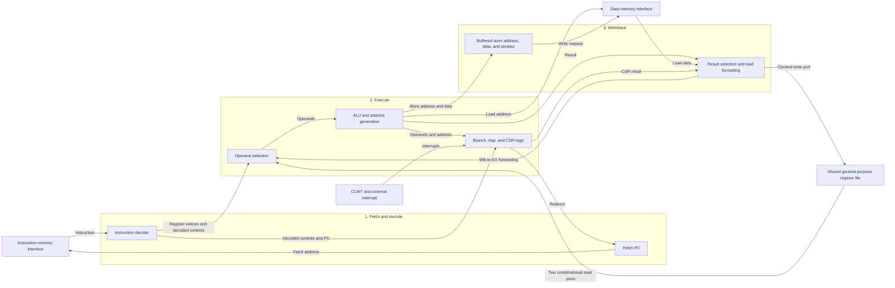
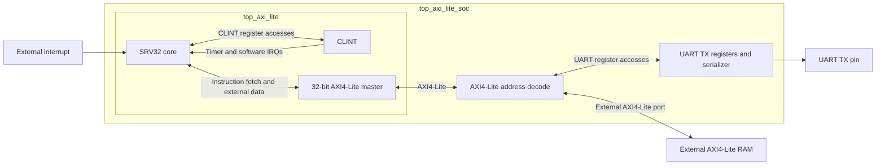

# SRV32 architecture

SRV32 is an in-order, three-stage, 32-bit RISC-V core. It implements RV32I
with configurable multiplication and division (RV32M) and a reduced
register file option (RV32E). The core boots at address `0x00000000`.
The top-level wrappers connect the core's instruction and data interfaces to
RAM and route machine timer and software interrupt accesses to the CLINT.

## Core block diagram

## AXI4-Lite SoC block diagram

The core fetches its reset instruction from external RAM at
`0x00000000`. The SoC routes the two UART register addresses to the
on-chip transmitter and sends other AXI4-Lite requests to the external
port. The core wrapper handles CLINT data accesses before they reach
the AXI4-Lite master. [SoC RTL](../rtl/top_axi_lite_soc.v),
[Core wrapper RTL](../rtl/top.v)

## Pipeline

1. **Fetch and decode (F/D).** The fetch PC addresses instruction memory.
   The decoder extracts the source and destination register indices,
   immediate, and controls. The F/D-to-EX boundary latches those fields
   along with the instruction PC.
2. **Execute (EX).** The register file provides two combinational read
   ports. Each operand mux can forward a matching result from WB.
   The ALU computes arithmetic and logic results and forms load and store
   addresses. EX also resolves branches, checks alignment, and handles
   CSR operations and trap redirects. Loads request memory from EX.
3. **Writeback (WB).** A clocked write port commits the selected ALU,
   CSR, or load result. Load formatting selects the addressed byte or
   halfword and applies sign or zero extension. Stores use a separate
   path with buffered address, data, and byte strobes. Reads of `x0`
   return zero.

The register file is shared by EX and WB. For example, after
`add x5, x2, x3`, a following instruction that reads `x5` can receive
the sum through the forwarding mux during the same cycle that WB
writes it to the register file.

## Memory configurations

- **Split RAM (`top`).** Instruction fetch, data reads, and data writes
  use separate ports. The direct-RAM pipeline flushes two slots on a
  taken branch. [RTL](../rtl/top.v)
- **Single RAM (`top_single_ram`).** A shared synchronous port
  arbitrates pending stores first, then loads, then instruction fetches.
  A read response can arrive on the same edge as the next request.
  Sequential fetch can sustain one word per clock with one-cycle
  RAM responses. Loads and stores consume shared port cycles.
  Run this configuration with `make top=1`. [RTL](../rtl/top.v)
- **AXI4-Lite (`top_axi_lite` and `top_axi_lite_soc`).** A serialized
  32-bit AXI4-Lite master carries instruction and data traffic. The SoC
  wrapper also decodes the internal UART TX registers, which default to
  `0x10000000` and `0x10000004`. [Master RTL](../rtl/top_axi_lite.v),
  [SoC RTL](../rtl/top_axi_lite_soc.v)

The single-RAM and AXI4-Lite wrappers enable the core's wait-state
interface. Required memory responses can hold pipeline progress.
A redirect can advance without waiting for a younger instruction fetch.
The wrapper discards any outstanding fetch response for the old path.

Data accesses in `0x90000000–0x9fffffff` are routed to the CLINT.
The CLINT implements the machine timer, timer compare, and software
interrupt registers. [Core RTL](../rtl/riscv.v), [CLINT RTL](../rtl/clint.v)
