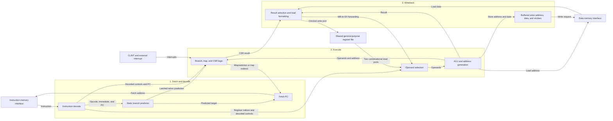
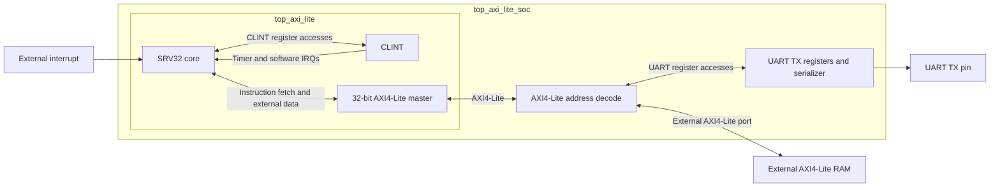

# SRV32 architecture

SRV32 is an in-order, three-stage, 32-bit RISC-V core. It implements RV32I
with configurable multiplication and division (RV32M) and a reduced
register file option (RV32E). The core boots at address `0x00000000`.
The top-level wrappers connect the core's instruction and data interfaces to
RAM and route machine timer and software interrupt accesses to the CLINT.
All three common-testbench configurations use buffered instruction responses
and the static predictor implemented in `rtl/riscv.v`. The adapters transport
memory requests and redirects; they do not contain prediction logic.

## Core block diagram

## AXI4-Lite SoC block diagram

The core fetches its reset instruction from external RAM at
`0x00000000`. The SoC routes the two UART register addresses to the
on-chip transmitter and sends other AXI4-Lite requests to the external
port. The core wrapper handles CLINT data accesses before they reach
the AXI4-Lite master. [SoC RTL](../rtl/top_axi_lite_soc.v),
[Core wrapper RTL](../rtl/top.v)

## Pipeline

1. **Fetch and decode (F/D).** The fetch PC addresses instruction memory.
   The decoder extracts the source and destination register indices,
   immediate, and controls. The F/D-to-EX boundary latches those fields
   along with the instruction PC and predicted-taken bit. Decode can select
   a predicted direct target for the next fetch.
2. **Execute (EX).** The register file provides two combinational read
   ports. Each operand mux can forward a matching result from WB.
   The ALU computes arithmetic and logic results and forms load and store
   addresses. EX also resolves branches, checks alignment, and handles
   CSR operations and trap redirects. Loads request memory from EX.
3. **Writeback (WB).** A clocked write port commits the selected ALU,
   CSR, or load result. Load formatting selects the addressed byte or
   halfword and applies sign or zero extension. Stores use a separate
   path with buffered address, data, and byte strobes. Reads of `x0`
   return zero.

The register file is shared by EX and WB. For example, after
`add x5, x2, x3`, a following instruction that reads `x5` can receive
the sum through the forwarding mux during the same cycle that WB
writes it to the register file.

Instruction fields and prediction state advance only when EX advances.
Stalls hold that state; buffered-mode reset and redirect bubbles are marked
invalid and do not increment the retired-instruction count. A load is issued
from EX, but its response path depends on the selected memory adapter.

## Static branch prediction

`STATIC_BRANCH_PREDICTOR` defaults to `1` in the core and wrappers. Prediction
is active only with the buffered core interface (`MEM_WAIT_STATES=1`):

- Legal conditional branches with a negative immediate predict taken.
- Forward conditional branches, including a zero offset, predict not taken.
- Direct JAL instructions predict taken when the target is word-aligned.
- A backward branch also requires a word-aligned target to predict taken.
- JALR and system returns resolve in EX; they are not predicted.

The target is the decode PC plus the sign-extended immediate. No branch-target
buffer, history table, or return-address stack is present. The architectural
taken decision is kept separate from the misprediction decision so that
alignment checks, traps, and interrupt return PCs use the actual outcome.

EX redirects on a mismatch between actual and predicted taken state. For an
unexpectedly taken branch or jump it selects the resolved target; for a
predicted-taken branch that falls through it selects `ex_pc + 4`. Traps take
priority over this correction, and correction takes priority over a new
decode-stage prediction. Misaligned taken targets are handled by the trap
path rather than being predicted.

A correct prediction avoids an EX recovery flush. It does not guarantee
zero-cycle control-flow overhead: the decoder's redirect can suppress a
sequential request, and the adapter may wait for the predicted target fetch.
With prediction disabled, taken branches, JAL, and JALR resolve in EX; a
not-taken conditional branch does not redirect. The one-cycle direct-RAM
models use two refill cycles after an EX recovery redirect. AXI-Lite refill
latency depends on the external response.

`make ... branch_predictor=0` disables prediction and `branch_predictor=1`
enables it. The Makefiles pass this as the testbench's `BRANCH_PREDICTOR`
parameter, which is forwarded to the selected RTL wrapper. The ISS models
the selected timing policy for comparison, but all hardware prediction and
recovery logic remains in [riscv.v](../rtl/riscv.v).

## Memory configurations

- **Non-shared instruction/data RAM (`top=0`).** `top_ram` with
  `SINGLE_PORT=0` wraps `top` using the buffered core interface. Instruction
  responses can be held until the pipeline consumes them. Data reads and
  writes use independent ports; a load is accepted at the EX/WB boundary
  and must supply its result during the following WB cycle. This preserves
  synchronous load throughput without an added EX response wait.
  [RTL](../rtl/top.v)
- **Shared instruction/data RAM (`top=1`).** `top_ram` with `SINGLE_PORT=1`
  arbitrates a shared synchronous port. The `top_single_ram` module remains
  as a compatibility wrapper around that adapter. The shared port
  arbitrates pending stores first, then loads, then instruction fetches.
  A read response can arrive on the same edge as the next request.
  Sequential fetch can sustain one word per clock with one-cycle
  RAM responses. Loads and stores consume shared port cycles.
  Run this configuration with `make top=1 hello`. [RTL](../rtl/top.v)
- **AXI4-Lite (`top_axi_lite` and `top_axi_lite_soc`).** A serialized
  32-bit AXI4-Lite master carries instruction and data traffic. The SoC
  wrapper also decodes the internal UART TX registers, which default to
  `0x10000000` and `0x10000004`. [Master RTL](../rtl/top_axi_lite.v),
  [SoC RTL](../rtl/top_axi_lite_soc.v)

All three testbench configurations enable the core's wait-state interface.
The low-level `top` module still defaults to the legacy
`MEM_WAIT_STATES=0` interface, which uses fixed flush timing and does not
activate the predictor. Required memory responses in the buffered wrappers
can hold pipeline progress; non-shared data RAM retains the fixed one-cycle
read contract described above.
A redirect can advance without waiting for a younger instruction fetch.
The wrapper discards any outstanding fetch response for the old path.
An issued AXI request must still complete; a discarded response's error must
not become an architectural access fault. Real instruction/load/store access
faults in the AXI-Lite wrapper record the faulting PC and address in the
machine trap CSRs.

For straight-line code with one-cycle RAM responses and no branches, traps,
or external stalls, non-shared RAM can sustain one instruction per cycle.
Shared RAM needs one instruction-read cycle per instruction plus one port
cycle per external data load or store. The store's port wait can be observed
against the following instruction because stores are buffered in WB. These
are throughput costs, not full instruction latency through all three stages.

Data accesses in `0x90000000–0x9fffffff` are routed to the CLINT.
The CLINT implements the machine timer, timer compare, and software
interrupt registers. [Core RTL](../rtl/riscv.v), [CLINT RTL](../rtl/clint.v)

## Simulation and validation

All RTL simulation configurations use [testbench.v](../testbench/testbench.v).
`MEMORY_MODE=0` selects non-shared RAM, `1` shared RAM, and `2` the AXI-Lite
SoC. `BRANCH_PREDICTOR` selects prediction and `UART_CLOCKS_PER_BIT` controls
the AXI-Lite UART test timing. The Makefile maps `top=0`, `top=1`, and `top=axi`
to these modes; named diagnostics default to non-shared RAM, whereas a plain
simulator build defaults to AXI-Lite.

`make -C sim check-branch` runs CoreMark, IRQ, exception, and CSR diagnostics
with prediction on/off in both RAM configurations. The root diagnostic targets
compare RTL and ISS instruction/result traces, including timing CSR reads,
after removing per-line timestamps. `make -C sim check` also runs AXI-Lite
RAM/UART, access-fault, interrupt, retirement, and firmware scenarios. The
[README benchmark tables](../README.md#benchmarks) identify the measured
compiler, memory configuration, prediction setting, and CPI scope.
